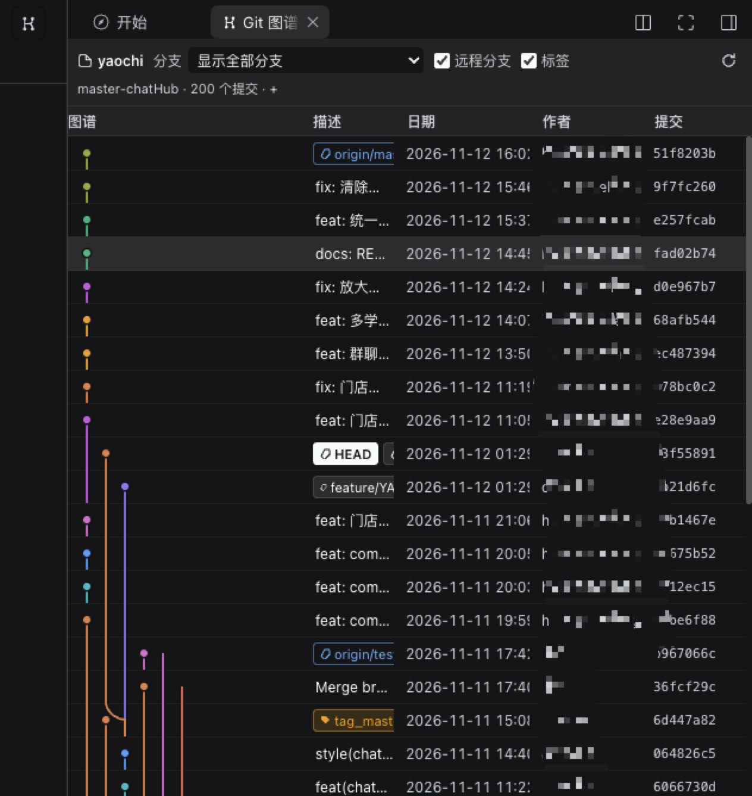
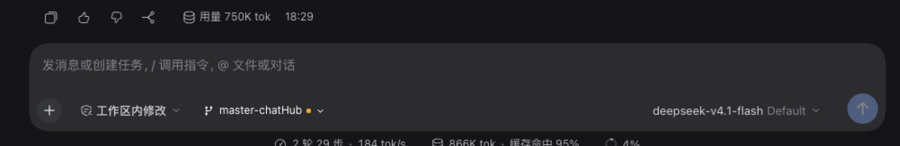
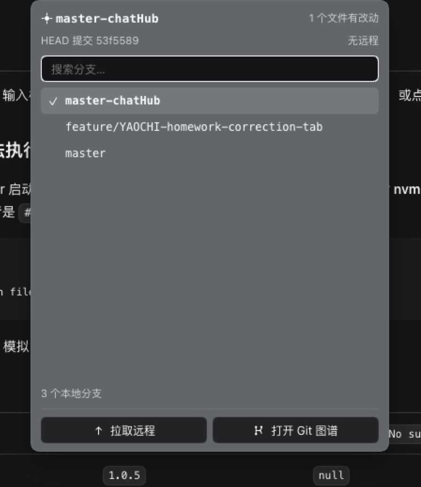

# dsh-plugin-git-graph · Git 图谱

[](https://www.npmjs.com/package/dsh-plugin-git-graph)
[](https://www.npmjs.com/package/dsh-plugin-git-graph)
[](LICENSE)
[](https://github.com/choukin/sh-plugin-git-graph)

在 DeepSeek Harness 的右侧栏浏览当前项目的 Git 提交图谱，并在输入框旁直接切换分支。交互参照 VS Code Git Graph / SourceTree，读写分离：除了「切换分支」和手动触发的 `git fetch`，其余全部只读。

## 截图

**提交图谱**：多泳道连线、HEAD / 远程 / 标签徽标，点击行看详情。



**分支胶囊**：在输入框工具栏里显示当前分支，点开即可搜索、切换。





## 功能

- **提交图谱**：`图谱 | 描述 | 日期 | 作者 | 提交` 表格，左侧多泳道彩色连线（分支、合并、交叉）；描述前带 `HEAD`、本地分支、`origin/*`、`tag` 徽标——徽标始终可见，空间不足时先缩短描述、再缩短徽标文字，不会把远端分支 / 标签挤到看不见。
- **提交详情**：点击任一行，在表格上方弹出不透明浮层——完整哈希（可复制）、作者 / 时间 / 父提交、提交信息、变更文件树与单文件 diff。
- **大仓库友好**：行虚拟化，滚动到底自动加载下一页（默认每页 200 条）。
- **跟随会话**：标签页读取当前会话的工作目录，切到别的仓库的会话时自动切换；子目录、嵌套仓库、worktree 都能解析。
- **分支胶囊**：位于输入框工具栏（模型选择器左侧），显示当前分支，工作区有改动时带黄点。点开可搜索并 `git switch` 切换，另有「拉取远程」「打开 Git 图谱」。
- **切换守卫**：分支不存在或名字非法、已在别的 worktree 检出、有未完成的 merge / rebase、有未解决冲突、改动会被覆盖——都直接报出原因，不碰 index。

## 安装

```sh
npm install dsh-plugin-git-graph
```

（发布在内网源 `https://npm.ledupeiyou.com/`。）装进 Harness profile 后，用插件管理启用，或把它加进 profile `package.json` 的 `dsh.profile.bundles`，并保留 `cordis.patch.yml` 里的 `git-graph-panel` 行。**Host 半区不会热替换**：装好或升级后需要重启 Harness 进程。

分支下拉把**本地分支**和**远程分支**（`origin/*` 等）分成两组；选中远程分支时按那条追踪引用过滤。远端分支列表跟随「远程分支」勾选，未勾选时不显示。

## 配置

`git-graph-panel` 行的 `config`（也可在插件设置里改）：

| 字段 | 默认值 | 说明 |
| --- | --- | --- |
| `workingDirectory` | `''` | 固定查看的仓库（或其子目录）。留空 = 跟随当前会话目录 |
| `pageSize` | `200` | 每页提交数（20–3000） |
| `enableFetch` | `false` | 工具栏是否提供「拉取远程」（`git fetch --all --prune`） |

## 实现要点

- **Host 半区**（`lib/`）：唯一路由 `/api/dsh-git-graph`，挂在 `connection.fetch` 上；`GET` 下发本次加载的页面令牌，`POST` 走 `state.rpc`。`webServer` 只作为没有 Connection 时的兜底，且必须是**精确**路由——在 `webServer` 注册 `/api/...` 前缀会抢走 Connection 的 `/api` 路由，导致所有请求 403。git 一律以固定 argv 调用（`LC_ALL=C`、超时、输出上限、提交号必须是十六进制、路径不能以 `-` 开头）。
- **Client 半区**（`client.js`）：纯 JS 工厂，只依赖 `react`，注册右侧栏标签、标签标题、输入框分支胶囊和标题栏按钮。输入框是 `position: fixed` 后代的包含块，所以分支弹层 **portal 到 `document.body`**，位置直接写成内联样式（不经过 React state，测量不会反过来触发渲染）。颜色只用 `--dsw-alias-*` 主题变量，深浅色跟随宿主。

## 开发

```sh
npm run check   # 语法检查
npm test        # 临时仓库上的真实 git 断言 + 路由/令牌断言
```

## 边界

- 只做 `git switch` 与 `git fetch`：不 commit / reset / rebase / push。
- 仓库取自当前会话的工作目录；不在 Git 仓库里的会话不显示胶囊，标签页显示引导空态。
- `CVS` / `SVN` 等其他版本库不在范围内。

## License

MIT © choukin
